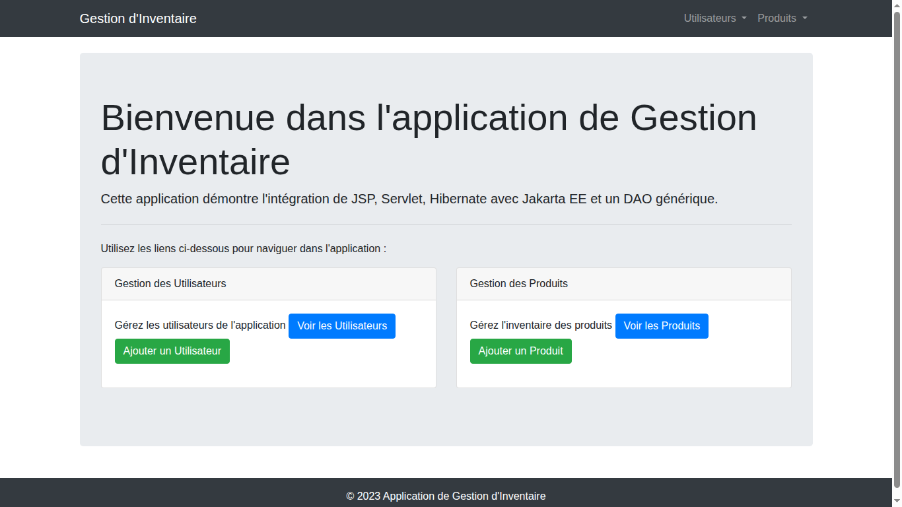
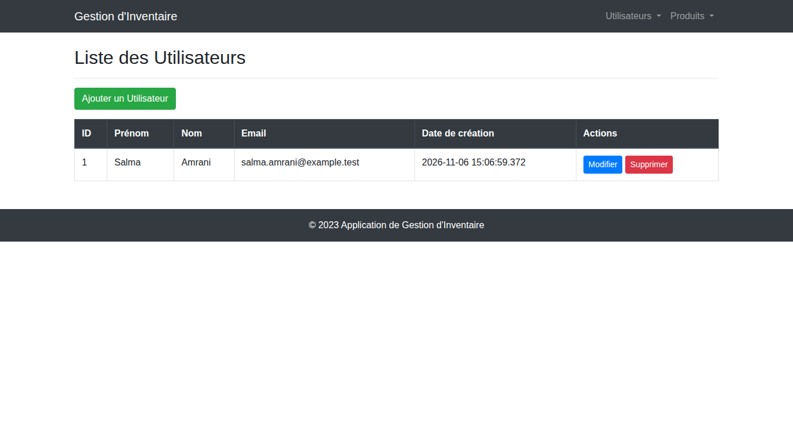
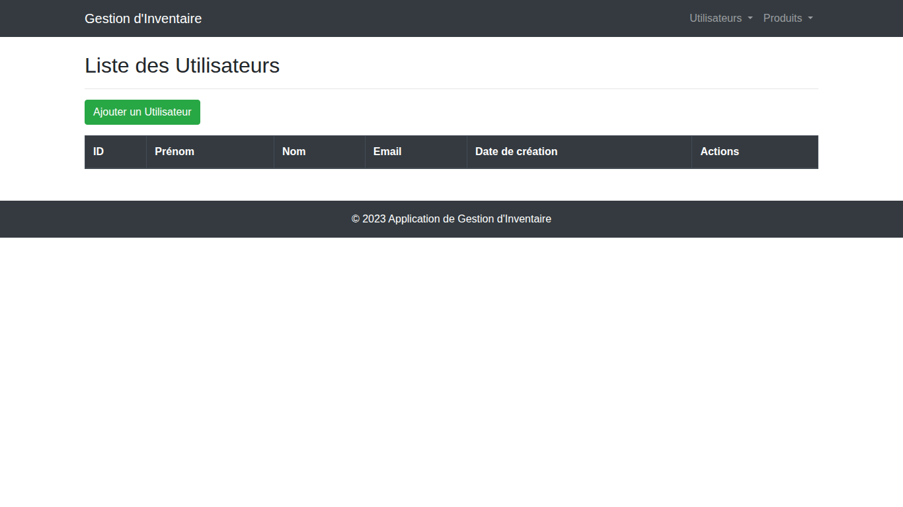
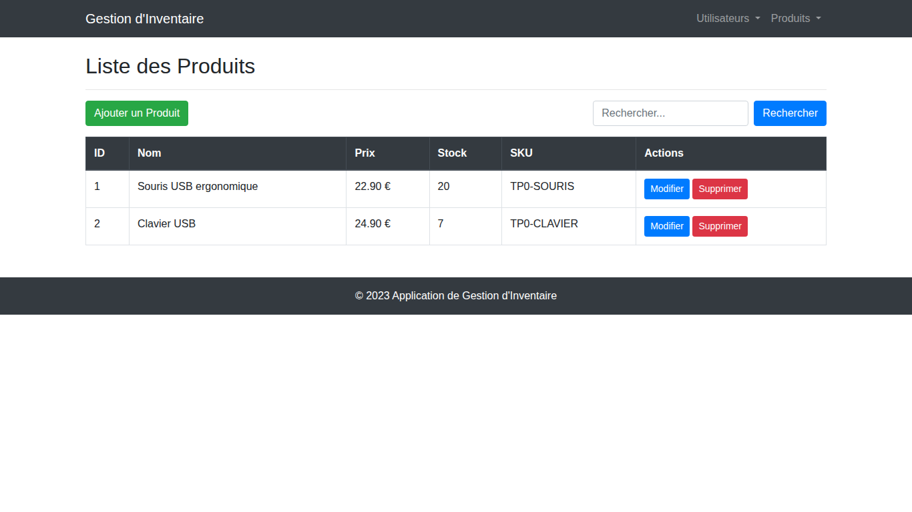
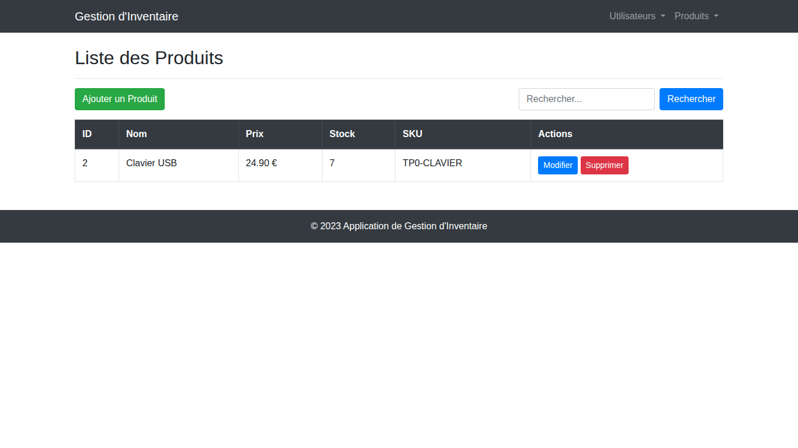

# TP0 — JSP, Servlet et Hibernate avec DAO générique et Jakarta EE

Dans ce TP, nous avons réalisé une application de gestion d’inventaire. Les servlets traitent les requêtes et les pages JSP affichent les formulaires et les listes. Hibernate enregistre les utilisateurs et les produits. Les DAO spécialisés réutilisent les opérations communes du DAO générique.

## Lancement

Compiler le projet avec `mvn clean package`, puis déployer le fichier `target/inventory-management.war` sur Tomcat 10. L’application est accessible à l’adresse [http://localhost:8080/inventory-management/](http://localhost:8080/inventory-management/).

Pour MySQL, renseigner les propriétés JVM `hibernate.connection.username` et `hibernate.connection.password` dans la configuration locale de Tomcat. Dans IntelliJ IDEA, ces propriétés se passent dans les options VM avec `-Dhibernate.connection.username=VOTRE_UTILISATEUR` et `-Dhibernate.connection.password=VOTRE_MOT_DE_PASSE`.

Les captures ont été réalisées avec Java 17, Tomcat 10.1 et la base H2 en mémoire proposée dans l’énoncé. Le fichier `hibernate.cfg.xml` du projet est configuré pour MySQL par défaut.

## Accueil

La page d’accueil donne accès aux deux parties de l’application, la gestion des utilisateurs et la gestion des produits.

## Scénario 1 — Gestion des utilisateurs

### Ajout d’un utilisateur

Après l’enregistrement du formulaire, Salma Amrani apparaît dans la liste avec l’adresse `salma.amrani@example.test`.

### Modification d’un utilisateur

Le bouton **Modifier** ouvre le formulaire avec les valeurs existantes. Après l’enregistrement, la liste affiche le nom El Amrani et la nouvelle adresse `salma.elamrani@example.test`.

### Suppression d’un utilisateur

Le bouton **Supprimer** affiche une demande de confirmation. Après validation, la liste des utilisateurs est vide.

## Scénario 2 — Gestion des produits

### Ajout d’un produit

Le produit **Souris USB** apparaît dans la liste avec un prix de 18,90 €, un stock de 12 et le SKU `TP0-SOURIS`.

### Recherche d’un produit

Avec deux produits enregistrés, la recherche `souris` affiche uniquement **Souris USB**. Le clavier est exclu des résultats.

### Modification d’un produit

Le produit devient **Souris USB ergonomique**. La liste affiche le nouveau prix de 22,90 € et le stock de 20, avec le même SKU.

### Suppression d’un produit

Après confirmation, la souris disparaît de la liste. Le clavier reste affiché.
